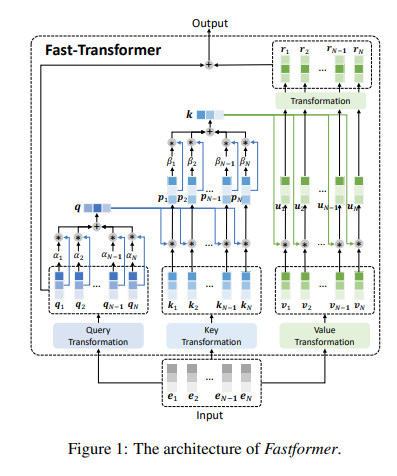

# Fastformer — PyTorch

[](https://github.com/talipturkmen/Fastformer-Pytorch/actions/workflows/tests.yml)
[](https://github.com/talipturkmen/Fastformer-Pytorch/actions/workflows/lint.yml)
[](pyproject.toml)
[](https://pytorch.org)
[](LICENSE)
[](https://github.com/astral-sh/ruff)
[](https://arxiv.org/abs/2108.09084)

A PyTorch implementation of [Fastformer: Additive Attention Can Be All You Need](https://arxiv.org/abs/2108.09084) (Wu et al., 2021).

Fastformer replaces pairwise self-attention with **additive attention**. The model pools
the queries into one global query vector. This vector modulates each key. Then the model
pools the modulated keys into one global key, which modulates each value. Each step is
linear in sequence length, so time and memory are **O(n)**, not O(n²).



## Installation

```sh
pip install git+https://github.com/talipturkmen/Fastformer-Pytorch.git
```

Requires Python ≥ 3.10 and PyTorch ≥ 2.0.

## Usage

```python
import torch
from fast_transformer_torch import FastTransformer

model = FastTransformer(
    num_tokens=20000,
    dim=512,
    depth=2,
    max_seq_len=4096,
    absolute_pos_emb=False,  # False: rotary embeddings, True: learned absolute embeddings
)

x = torch.randint(0, 20000, (16, 4096))
mask = torch.ones(16, 4096, dtype=torch.bool)  # True = real token, False = padding

logits = model(x, mask=mask)  # (16, 4096, 20000)
```

`mask` is optional. Padded positions do not contribute to the global query or the global key.

You can also use the attention layer alone:

```python
from fast_transformer_torch import FastAttention

attn = FastAttention(dim=512, heads=8, dim_head=64)
out = attn(torch.randn(16, 4096, 512), mask=mask)  # (16, 4096, 512)
```

### Options

| Argument | Default | Description |
| --- | --- | --- |
| `num_tokens` | — | Vocabulary size |
| `dim` | — | Model width |
| `depth` | — | Number of attention + feed-forward blocks |
| `max_seq_len` | — | Longest accepted sequence |
| `heads` | `8` | Attention heads |
| `dim_head` | `64` | Width of each head (must be even for rotary embeddings) |
| `ff_mult` | `4` | Feed-forward hidden width multiplier |
| `absolute_pos_emb` | `False` | Use learned absolute position embeddings instead of rotary |
| `share_attn_logit_weights` | `True` | Share the query/key attention-logit projections across layers, as in the paper |

## Performance

The two modulated tensors, `p = k ⊙ global_q` and `u = v ⊙ global_k`, are never materialized. Both are only used through linear maps, so the global vectors are folded into those maps instead. Rotary embeddings use cached half-width cos/sin tables and rotate q, k and v in one call. Both additive-attention pooling steps are single-query attention, so they run through `torch.nn.functional.scaled_dot_product_attention`. On CUDA that dispatches to PyTorch's fused kernels; pass `use_sdpa=False` to `FastAttention` to use plain einsum instead. The result is exactly the same function as v0.2.0: the tests check outputs and gradients against the original implementation in float64.

Forward + backward of one `FastAttention` layer (batch 4, dim 512, 8 heads of 64, 16,384 tokens):

| Device | Rotary | v0.2.0 | v0.3.0 |
| --- | --- | --- | --- |
| Apple MPS | yes | 227 ms · 1,312 MiB | **137 ms · 781 MiB** |
| Apple MPS | no | 91 ms · 1,160 MiB | 88 ms · 905 MiB |
| CPU | yes | 524 ms · 1,056 MiB | 509 ms · 781 MiB |
| CPU | no | 389 ms · 1,288 MiB | 391 ms · 905 MiB |

Memory is the activation memory autograd keeps for the backward pass. Reproduce with `python benchmarks/bench_attention.py --device mps --impl reference` and `--impl sdpa` (or `--impl einsum`).

## Development

```sh
git clone https://github.com/talipturkmen/Fastformer-Pytorch.git
cd Fastformer-Pytorch
pip install -e ".[dev]"

pytest
ruff check . && ruff format --check .
```

## Acknowledgements

Based on [lucidrains' PyTorch implementation](https://github.com/lucidrains/fast-transformer-pytorch).

## Citation

```bibtex
@misc{wu2021fastformer,
    title         = {Fastformer: Additive Attention Can Be All You Need},
    author        = {Chuhan Wu and Fangzhao Wu and Tao Qi and Yongfeng Huang and Xing Xie},
    year          = {2021},
    eprint        = {2108.09084},
    archivePrefix = {arXiv},
    primaryClass  = {cs.CL}
}
```

## License

[Apache 2.0](LICENSE)
